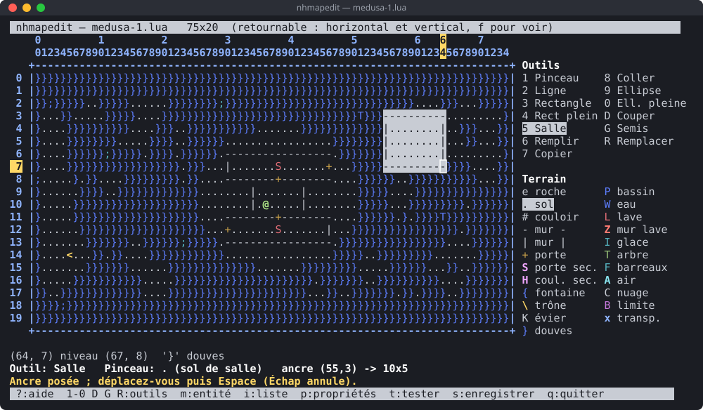

# nhmapedit — éditeur de cartes NetHack en mode terminal

Petit éditeur plein écran (Python 3 + curses, sans dépendance externe) pour
créer et modifier les cartes des niveaux spéciaux de NetHack 5.0 / 3.7.
Ces niveaux sont des scripts Lua (`dat/*.lua`) qui utilisent `des.map()`,
`des.monster()`, `des.stair()`…



## Lancement

```sh
python3 nhmapedit.py                    # nouvelle carte 75x19
python3 nhmapedit.py mon_niveau.lua     # ouvre (ou crée) un fichier
python3 nhmapedit.py --new 40x12 petit.lua
```

Il faut un terminal d'au moins 80x24 ; à partir d'environ 105 colonnes, une
palette (outils et terrains) s'affiche à droite de la carte. Les cartes plus
grandes que l'écran défilent.

## Utilisation

Appuyez sur `?` dans l'éditeur pour l'aide complète.

| Touche | Action |
|---|---|
| Flèches, `h j k l` | déplacer le curseur (Maj+flèches, PgPréc/PgSuiv, Début/Fin : rapide) |
| `. # - \| + S H { \ K } P W L Z I T F A C B x` | choisir ce terrain comme pinceau (et peindre si l'outil est le Pinceau) |
| `e` | pinceau « roche » (espace) |
| `y` | pipette : prend comme pinceau le terrain sous le curseur (aussi au clic droit) |
| `1`…`8` | outil : Pinceau, Ligne, Rectangle, Rectangle plein, Salle, Remplissage, Copier, Coller |
| `9`, `0` | outil Ellipse, Ellipse pleine (un cercle est une ellipse tracée dans un carré) |
| `G` | outil Semis aléatoire : peint au hasard une partie des cases d'une zone, selon une densité en % |
| `R` | remplacer un terrain par un autre, sur toute la carte ou dans une zone, avec une proportion en % (comme `des.replace_terrain()`) |
| `M` | symétrie : aucune → gauche/droite → haut/bas → les deux ; pinceau, formes, remplissage, semis et remplacement sont reproduits en miroir autour du centre de la carte (axes marqués `*` sur le cadre ; le collage et les entités ne sont pas reflétés) |
| `E` | insérer une ligne ou une colonne au curseur, ou la supprimer ; la carte et les entités sont décalées |
| `D` | outil Couper : pour déplacer une zone, terrain et entités compris ; la zone est vidée puis l'outil Coller la repose |
| `b` | bibliothèque de modèles : temple, boutique, fontaine, salle du trône… ; le modèle choisi va dans le presse-papiers (voir « Import et export ») |
| `X`, `Y`, `O` | presse-papiers : miroir gauche/droite, miroir haut/bas, rotation d'un quart de tour (entités comprises) |
| Espace / Entrée | appliquer l'outil (outils à deux points : ancre puis tracé ; Échap annule) |
| `d` | crayon baissé : peint en se déplaçant (tout le trait s'annule en une fois) |
| `a` | avance automatique après chaque caractère tapé (pratique pour « taper » une carte) |
| `m` | placer une entité : escalier, échelle, autel, monstre, objet, piège, porte, gravure |
| `r` | répéter la dernière entité placée sous le curseur |
| Suppr, Retour arrière, `z` | supprimer les entités sous le curseur |
| `i` | liste des entités (Entrée : y aller, `e` : modifier, `d` : supprimer) |
| Tab | afficher / masquer les entités (un symbole souligné signale plusieurs entités sur la case ; la barre d'état les liste toutes) |
| `c` | afficher / masquer les règles de coordonnées (colonnes en haut, lignes à gauche) |
| `f` | aperçu du retournement aléatoire que NetHack applique aux niveaux sans `noflip` : aucun → horizontal → vertical → les deux (l'édition reste possible, les règles gardent les vraies coordonnées) |
| `J` | rendu « comme dans le jeu » : murs en traits avec leurs coins et jonctions, sol en points, symboles et couleurs du jeu, portes et couloirs secrets cachés (l'édition reste possible) |
| `p` | propriétés : taille, `level_init`, drapeaux, placement (halign/valign ou x,y), éclairage, place du niveau dans le donjon (`dungeon.lua`, voir plus bas) |
| `v` | vérifier la carte : largeur > 76, entités dans les murs, escaliers en double, connexité… (voir « Vérification ») |
| `t` | tester : copie la carte dans le répertoire du jeu ; avec tmux, lance NetHack et y charge la carte (voir plus bas) |
| `u` / `U` (ou Ctrl-R) | annuler / rétablir |
| `n`, `o`, `s`, `w` | nouveau, ouvrir, enregistrer, enregistrer sous (Tab complète les chemins) ; `o` sur un `.txt` importe une carte en texte brut, `w` vers un `.txt`, `.svg` ou `.png` l'exporte en texte ou en image (voir « Import et export ») |
| `q` | quitter |

La souris est gérée : clic = déplacer le curseur et appliquer l'outil,
glisser = peindre (Pinceau) ou tracer (Rectangle, Ligne, Salle…),
clic droit = pipette.

Les listes de monstres et d'objets se filtrent en tapant une partie du nom.
Une lettre seule (`d`, `D`…) donne un monstre aléatoire de cette classe, un
symbole seul (`!`, `?`…) un objet aléatoire de cette classe. Sur la carte,
les monstres et objets aléatoires ont un style commun : fond magenta, avec
le symbole de leur classe, ou `?` quand tout est aléatoire.

Après le choix d'un monstre ou d'un objet, un formulaire présente ses
options courantes ; Entrée modifie la ligne choisie, Échap termine :

- monstres : `peaceful`, `asleep`, `female`, `invisible`, `cancelled`,
  `waiting`, `name`, `appear_as`, `m_lev_adj`, `keep_default_invent` ;
- objets : `buc` (dans une liste), `spe`, `quantity` (un entier ou
  `random`), `name`, `achievement`, `montype` (dans la liste des monstres),
  `buried`, `locked`, `trapped`, `eroded`, `greased`, `lit`.

Les cases à cocher passent de « défaut » (option absente) à oui (`1`), non
(`0`), puis à nouveau défaut. Les autres options se saisissent sur la
dernière ligne, sous la forme `fleeing=5, stunned=1`.

La ligne « inventaire » d'un monstre, et « contenu » d'un objet (coffre,
sac, statue…), ouvrent la liste de ses objets : Entrée ou `e` modifie un
objet (avec son propre formulaire, y compris son contenu : un sac dans un
coffre), `d` le supprime, « + ajouter un objet » en crée un. Ils sont
écrits sous la forme `inventory = function() des.object(...); end`.

## Fichiers existants

L'éditeur ouvre n'importe quel niveau de `dat/` qui contient un `des.map()`.
Il édite :

- `des.level_init()` et `des.level_flags()` ;
- la **première** carte `des.map()` du fichier ;
- les entités à **coordonnées fixes** écrites après cette carte (escaliers,
  échelles, autels, monstres, objets, pièges, portes, gravures), y compris
  l'inventaire des monstres (`inventory = function() ... end`) et le
  contenu des conteneurs et des statues (`contents = function() ... end`)
  quand ces fonctions ne contiennent que des `des.object()` littéraux.

Tout le reste du script (régions, boucles, éléments aléatoires, autres
cartes…) est conservé tel quel à l'enregistrement. Un fichier ouvert puis
enregistré sans modification reste identique octet pour octet. Lors du
premier enregistrement, l'original est gardé sous `fichier.lua~`.

Les coordonnées des entités sont relatives à la carte, comme dans les
scripts NetHack. La barre d'état affiche aussi la position réelle de la
case dans le niveau de 80x21 (`niveau (x,y)`), calculée comme le fait
NetHack à partir de `halign`/`valign` ou de la position fixe de la carte ;
elle vaut `(?)` quand la carte est placée au hasard.

## Import et export

- **Texte brut** : `o` sur un fichier `.txt` importe une carte ASCII seule,
  sans le Lua autour, comme un nouveau niveau. `s` l'enregistre ensuite
  en `.lua` à côté du fichier texte. Les lignes vides autour sont
  ignorées, et les lignes courtes complétées par de la roche ; un
  caractère inconnu est signalé. À l'inverse, `w` (enregistrer sous)
  vers un nom en `.txt` exporte la carte seule, sans changer le fichier
  en cours.
- **Image** : `w` vers un nom en `.svg` ou en `.png` exporte la carte en
  image, telle qu'elle est affichée : symboles d'édition ou rendu « comme
  dans le jeu » (`J`), avec ou sans les entités (Tab). Le SVG est écrit
  directement. Le PNG est converti avec `rsvg-convert` ou ImageMagick
  (`magick`/`convert`), s'ils sont installés.
- **Modèles** : `b` ouvre la bibliothèque de modèles. Ce sont des morceaux
  de carte prêts à coller : temple, boutique, fontaine décorée, salle du
  trône, coffre-fort, île entourée de douves, escaliers. Le modèle choisi
  va dans le presse-papiers, entités comprises, et l'outil Coller est
  activé ; `X`, `Y` et `O` le retournent ou le font pivoter. La dernière
  ligne de la liste enregistre le presse-papiers comme nouveau modèle.
  Les modèles livrés sont dans `modeles/`, les vôtres dans
  `~/.config/nhmapedit/modeles/`. Un modèle est un petit niveau `.lua`
  ordinaire, qu'on peut aussi ouvrir et modifier ; sa première ligne
  `-- Modèle nhmapedit : Titre` donne son titre, les commentaires
  suivants sa description.
- **Sauvegarde de secours** : quand la carte est modifiée, l'éditeur
  écrit au plus une fois par minute une sauvegarde de secours, à côté du
  fichier (`carte.lua.nhme-autosave`). Pour une carte sans nom, elle va
  dans `~/.cache/nhmapedit/`. Elle est supprimée à l'enregistrement et
  quand on quitte normalement. Si l'éditeur ou le terminal s'est arrêté
  brutalement, la réouverture du fichier propose de la récupérer : la
  carte reprend son état, à enregistrer avec `s`. Les salles à thème
  n'en ont pas.

## Vérification

La touche `v` liste les problèmes de la carte. Le premier caractère d'un
message donne sa gravité : `!` erreur, `?` à vérifier, `-` remarque.

**Connexité.** L'éditeur cherche un chemin de l'escalier (ou de
l'échelle) montant au descendant, comme le héros se déplace : en huit
directions, mais jamais en diagonale vers ou depuis une porte intacte.
Les portes sans battant (`nodoor`) ou cassées font exception. Il précise
si le chemin passe par une porte ou un couloir secret (`S`, `H`), ou s'il
faut traverser l'eau ou la lave. Il signale aussi les zones fermées, par
exemple une salle sans porte ou une salle dont les portes sont posées au
hasard par le script. Une zone qui touche le bord d'une carte plus petite
que le niveau peut être reliée au reste par le jeu : l'éditeur le
précise.

**Règles de NetHack.** L'éditeur signale aussi :
- une carte trop large, ou qui déborde du niveau de 80x21 une fois placée
  (`halign`/`valign` ou position fixe) ;
- une porte dans un coin de mur, ou qui n'est encadrée par aucun mur ;
- un escalier, une échelle ou un autel dans l'eau ou la lave, ou sur un
  terrain que le jeu remplacera ;
- un autel hors d'une salle `temple` (lue dans les `des.region()` du
  script) : il n'aura pas de prêtre ;
- une entité sur du terrain solide, ou hors de la carte ;
- deux escaliers montants (ou descendants) ;
- un monstre ou un objet dont le nom est inconnu.

**Vérification avec le vrai Lua.** Si un interpréteur Lua est disponible,
`v` exécute aussi le script complet, tel qu'il serait enregistré, avec une
bibliothèque `des` factice (`nhcheck_des.lua`). Le code que l'éditeur
conserve sans le montrer (boucles, conditions, fonctions) est donc
vérifié lui aussi :
- les erreurs de syntaxe et d'exécution (fonction inconnue…) ;
- les noms de monstres, d'objets et de pièges inconnus. Les formes que
  NetHack accepte sont reconnues : formes féminines (« priestess »), noms
  sans préfixe (« wishing »), descriptions (« walking shoes ») ;
- les drapeaux de niveau, styles de `level_init`, états de porte,
  alignements et types d'autel ou de gravure invalides ;
- les paramètres inconnus de `des.monster()` et `des.object()` ;
- les fonctions `des.*` inexistantes.

Les messages donnent le numéro de ligne dans le fichier. L'interpréteur
est cherché dans `$NHMAPEDIT_LUA`, puis `lua5.4` et `lua` dans le `PATH`.
S'il n'y en a pas, l'éditeur propose de compiler celui livré avec les
sources de NetHack (`lib/lua-5.4.8`), dans `~/.cache/nhmapedit/lua`. Les 93
niveaux de `dat/` passent cette vérification sans aucun message.

## Tester un niveau dans NetHack

Appuyez sur `t` : l'éditeur écrit l'état actuel de la carte (même non
enregistré) dans le répertoire de données du jeu, sous le nom
`nhme-<nom>.lua`. Le préfixe `nhme-` évite qu'un niveau du jeu portant le
même nom, rangé dans `nhdat`, soit chargé à la place du vôtre.

### Avec tmux : le jeu est lancé et la carte chargée automatiquement

Si `tmux` est installé, le premier appui sur `t` propose de lancer le jeu.
L'éditeur démarre alors `nethack -D -@` (mode wizard, personnage tiré au
hasard, sans introduction ni question du tutoriel), puis il tape lui-même
`#wizloaddes` et le nom du niveau. Le jeu s'ouvre :

- dans un panneau tmux à droite de l'éditeur, si l'éditeur tourne dans
  tmux et que la fenêtre fait au moins 170 colonnes ;
- sinon dans une nouvelle fenêtre tmux nommée `nethack` ;
- hors de tmux, dans une session `nhmapedit-jeu`, affichée dans un nouveau
  terminal (`$TERMINAL` ou `x-terminal-emulator`) si un affichage
  graphique est disponible, ou à rejoindre avec `tmux attach -t
  nhmapedit-jeu`.

Ensuite, chaque appui sur `t` recharge la carte dans ce même jeu. Si le
jeu attend une réponse (un menu, un message `--Plus--`), l'éditeur envoie
d'abord Échap pour revenir aux commandes. Quand on quitte le jeu, le
prochain `t` propose de le relancer. L'éditeur ne lance pas de second jeu
si une partie de NetHack est déjà en cours.

### Sans tmux

1. lancez le jeu en mode wizard : `nethack -D` ;
2. tapez `#wizloaddes`, puis le nom indiqué (par ex. `nhme-medusa-1`).

Après une modification, appuyez de nouveau sur `t` et refaites
`#wizloaddes`, sans relancer le jeu.

Le répertoire du jeu est cherché dans le fichier de configuration (clé
`repertoire`), dans `$NHMAPEDIT_HACKDIR`, puis
`~/nh/install/games/lib/nethackdir`, puis `../NetHack-5.0.0/playground`.
S'il n'est trouvé dans aucun de ces endroits, l'éditeur le demande.

Pour remplacer un vrai niveau du jeu, mettez le fichier dans `dat/` des
sources et recompilez/réinstallez (`make install`), ou référencez-le dans
`dat/dungeon.lua`.

## Ajouter le niveau au donjon

`#wizloaddes` charge une carte à la place du niveau courant. Pour que le
jeu la place lui-même dans le donjon, à une profondeur donnée, il faut la
déclarer dans `dat/dungeon.lua`. Dans les propriétés (`p`), « Donjon :
placer le niveau dans dungeon.lua… » le fait sans éditer le fichier à la
main :

1. choisissez le fichier (par défaut `../NetHack-5.0.0/dat/dungeon.lua`,
   ou `$NHMAPEDIT_DUNGEON`), puis le donjon (Dungeons of Doom, Gehennom,
   Mines…) ;
2. la liste de ses niveaux spéciaux s'affiche : « + ajouter ce niveau »
   ouvre un formulaire (nom du fichier, `base`, `range`, `chance`,
   `nlevels`, alignement, drapeaux `town`/`hellish`/`mazelike`/`roguelike`,
   `bonetag`, `chainlevel`) ; Entrée ou `e` modifie un niveau existant,
   `d` le retire ;
3. l'éditeur vérifie l'entrée (nom unique et d'au plus 14 caractères,
   `base` présente, `chainlevel` défini plus haut dans le fichier, au plus
   50 niveaux spéciaux), puis enregistre `dungeon.lua` aussitôt.
   L'original est gardé sous `dungeon.lua~`. Seule l'entrée du niveau est
   écrite : le reste du fichier, commentaires compris, ne change pas ;
4. après un ajout, l'éditeur propose de copier la carte sous
   `<nom>.lua` dans le répertoire du jeu.

Il reste à lancer `make install` dans les sources : cette commande range
le nouveau `dungeon.lua` dans `nhdat`. Le fichier du niveau, lui, est lu
directement dans le répertoire du jeu, puisqu'il n'est pas dans `nhdat`.
Le niveau apparaît dans les nouvelles parties ; en mode wizard,
`#wizwhere` donne la profondeur des niveaux spéciaux.

## Salles à thème

Ouvrir `dat/themerms.lua` (en argument ou avec `o`) affiche la liste de ses
salles à thème dessinées par `des.map()` : salles en L, en T, en croix,
circulaires… La dernière ligne, « + nouvelle salle à thème », en crée une
(nom et taille demandés, murs et sol déjà posés).

- Seule la carte de la salle s'édite. Le reste de l'entrée (fonction
  `contents`, `filler_region()`, fréquence…) et le reste du fichier ne
  changent pas : `s` remplace seulement le texte de la carte.
  L'original est gardé sous `themerms.lua~`.
- Une nouvelle salle est ajoutée à la fin de la table `themerooms`, avec
  `filler_region()` sur sa première case de sol, comme les salles du jeu.
  Une carte de taille différente peut demander d'ajuster à la main les
  coordonnées de `filler_region()` d'une salle existante.
- Les salles écrites seulement en code (`des.room()` imbriqués, comme
  « Fake Delphi ») n'ont pas de carte : elles n'apparaissent pas dans la
  liste. Les entités ne sont pas enregistrées dans une salle à thème.
- `w` (enregistrer sous) écrit la carte comme un niveau ordinaire.

Pour voir la salle en jeu, `t` rappelle les étapes. `themerms.lua` est
rangé dans `nhdat`, donc il faut lancer `make install` dans les sources.
Ensuite, en mode wizard, la variable `THEMERM` impose la salle :
`THEMERM="L-shaped" nethack -D`. Avec tmux, l'éditeur propose de lancer
le jeu ainsi.

## Configuration

Le fichier facultatif `~/.config/nhmapedit/config` (ou celui désigné par
`$NHMAPEDIT_CONFIG`) règle l'éditeur au démarrage. Il est au format INI ;
copiez [`docs/config.exemple`](docs/config.exemple) pour partir d'un
exemple commenté :

```ini
[jeu]
repertoire = ~/nh/install/games/lib/nethackdir
dungeon = ~/JEUX/NETHACK/NetHack-5.0.0/dat/dungeon.lua

[editeur]
taille = 75x19        ; taille d'une nouvelle carte
regles = oui          ; règles de coordonnées au démarrage
entites = oui         ; entités affichées au démarrage
unicode = auto        ; murs en traits Unicode : auto, oui, non
sauvegarde = 60       ; sauvegarde de secours (secondes, 0 : aucune)
langue = auto         ; auto (selon LANG), fr ou en

[couleurs]
} = bright_blue       ; couleur d'un terrain (roche, couloir pour « » et #)

[touches]
ctrl-z = u            ; touche tapée = touche de l'éditeur
```

Une clé inconnue ou une valeur invalide est signalée dans la barre d'état
au démarrage, sans empêcher l'éditeur de s'ouvrir.

## Fichiers

- `nhmapedit.py` : point d'entrée ; la classe `Editor` (état, touches,
  souris), qui hérite des modules `nhme_*` :
  - `nhme_common.py` : constantes, couleurs, symboles, aide, géométrie ;
  - `nhme_display.py` : affichage de la carte, des règles, du panneau et
    de la barre d'état ;
  - `nhme_dialogs.py` : fenêtres de saisie (invite, listes, formulaires) ;
  - `nhme_tools.py` : outils de dessin, presse-papiers, annulation ;
  - `nhme_entities.py` : entités, options, inventaires et contenus ;
  - `nhme_level.py` : propriétés, vérification, ouverture et
    enregistrement ;
  - `nhme_game.py` : test dans le jeu (tmux) et `dungeon.lua`.
- `nhlevel.py` : le modèle de niveau, la lecture et l'écriture du Lua.
- `nhdungeon.py` : la lecture et la modification de `dat/dungeon.lua`.
- `nhtheme.py` : les salles à thème de `dat/themerms.lua`.
- `nhexport.py` : import et export (texte brut, SVG, PNG), modèles ;
  `modeles/` : les modèles livrés.
- `nhcheck.py` : les vérifications (connexité, règles, Lua) ;
  `nhcheck_des.lua` est la bibliothèque `des` factice de la vérification
  Lua.
- `nhconfig.py` : lecture du fichier de configuration ;
  `docs/config.exemple` : un exemple commenté.
- `gen_data.py` : extrait des sources de NetHack les listes de monstres
  (avec leurs formes féminines et neutres), d'objets (avec leurs noms sans
  préfixe et leurs descriptions) et de pièges dans `nhdata.json`. À
  relancer si les sources changent : `python3 gen_data.py [chemin/vers/NetHack-5.0.0]`.
- `nhdata.json` : les données générées (394 monstres, 422 objets, 24 pièges).
- `docs/capture.py` : régénère la capture d'écran `docs/capture.svg` en
  pilotant l'éditeur dans un pseudo-terminal :
  `python3 docs/capture.py [--level niveau.lua] [--size 108x30]`.

## Tests

Les tests automatiques (bibliothèque standard `unittest`) se lancent depuis
la racine du dépôt :

```sh
python3 -m unittest            # ou : python3 -m unittest -v
```

Ils vérifient :
- l'aller-retour octet pour octet sur les niveaux de `dat/` ;
- la lecture et l'écriture des entités, inventaires et contenus ;
- les outils de dessin, le presse-papiers, la symétrie et l'annulation ;
- les modifications de `dungeon.lua` et de `themerms.lua` ;
- un parcours complet de l'interface dans un pseudo-terminal.

Les niveaux sont cherchés dans `../NetHack-5.0.0/dat`, ou dans
`$NHMAPEDIT_DAT`. Les tests qui en ont besoin sont sautés s'ils sont
absents. Le test de syntaxe utilise `luac` (ou `$NHMAPEDIT_LUAC`) quand il
est disponible.

## Licence

Le code de nhmapedit est distribué sous licence MIT (voir `LICENSE`).

`nhdata.json` est extrait des sources de NetHack (noms des monstres, objets
et pièges) et relève de la NetHack General Public License. NetHack est
Copyright (c) Stichting Mathematisch Centrum, Amsterdam, 1985 et ses
contributeurs.
